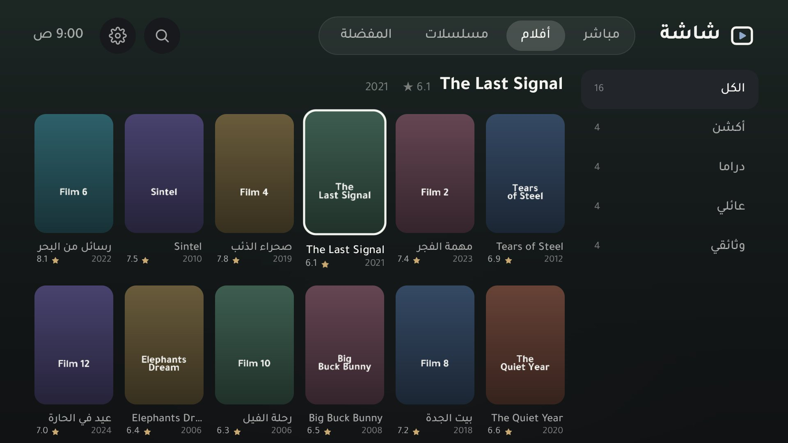
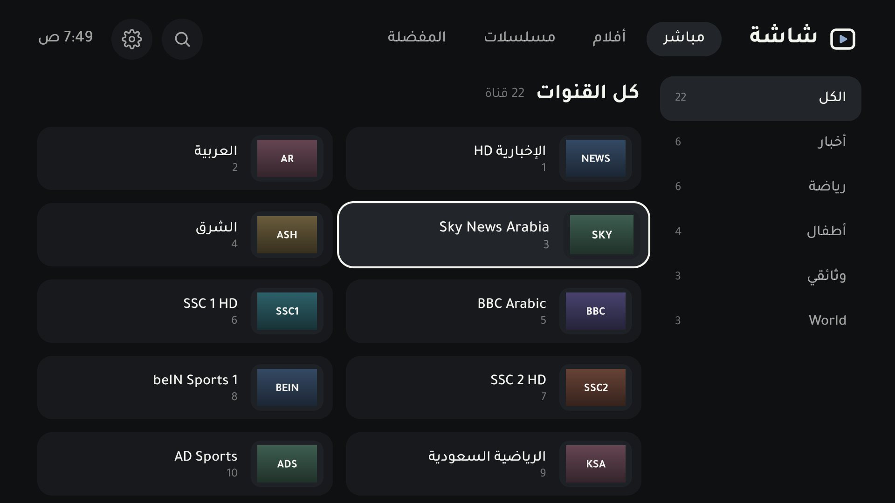
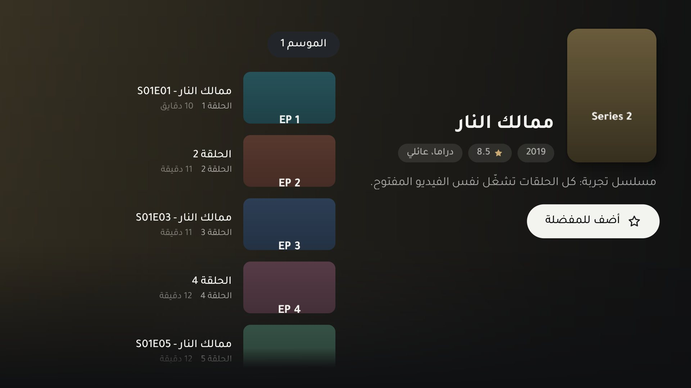

<div dir="rtl">

# شاشة

مشغّل IPTV عربي مفتوح المصدر لأندرويد TV والجوال. يقرأ حسابات **Xtream Codes** وروابط **M3U**، ويرتّب القنوات المباشرة والأفلام والمسلسلات بواجهة عربية هادية تشتغل بالريموت واللمس.

**التحميل والموقع:** [saadharazi.github.io/shasha](https://saadharazi.github.io/shasha/)

> شاشة مشغّل بس، وما فيه أي قنوات أو محتوى. تضيف بيانات اشتراكك أنت، وتبقى في جهازك.



## وش فيه

- **تشغيل ما يعلّق:** تحميل مسبق لين دقيقتين، وإعادة اتصال تلقائية من نفس المكان، ومراقب يرجّع البث لو وقف.
- **أضفه من جوالك:** شاشة «أضف اشتراك» على التلفزيون تعرض عنوان تفتحه من الجوال وتعبّي منه.
- **Xtream وM3U:** سيرفر واسم مستخدم وكلمة مرور، أو رابط قائمة. رابط `get.php` يتحول لحساب Xtream لحاله.
- **المباشر:** التصنيفات على اليمين، وتقلّب القنوات في المشغّل بفوق وتحت، مع البرنامج الحالي واللي بعده.
- **الأفلام والمسلسلات:** بوستر وتقييم وقصة، والمواسم والحلقات، والحلقة اللي بعدها تشتغل لحالها.
- **تابع المشاهدة والمفضلة:** يرجّعك لنفس الدقيقة، والمفضلة لكل اشتراك لحاله.
- **بحث يفهم العربي:** ما يفرق بين أ وإ وا ولا بين ة وه، ويتجاهل التشكيل.
- **أكثر من اشتراك** تبدّل بينها من الإعدادات.
- ما فيه إعلانات ولا تتبّع ولا حسابات.

| | |
|---|---|
|  |  |
|  |  |

## التثبيت

**على التلفزيون:** ثبّت تطبيق Downloader من Google Play، واكتب فيه `saadharazi.github.io/shasha/apk`، وثبّت الملف.

**على الجوال:** حمّل `shasha.apk` من [آخر إصدار](https://github.com/saadharazi/shasha/releases/latest) وافتحه.

يحتاج أندرويد 7 أو أحدث.

## البناء من الكود

بدون Android Studio ولا Gradle: سكربت واحد يستخدم أدوات SDK مباشرة.

المطلوب: Android SDK (build-tools وplatforms/android-34) وJDK 17 أو أحدث، وbash (في ويندوز: Git Bash). أول بناء ينزّل مكتبات المشغّل (ExoPlayer وGuava، حوالي 7 ميقا) من Google Maven وMaven Central ويتحقق من بصمتها (`iptv/fetch-libs.sh`).

```bash
ANDROID_SDK_ROOT=/path/to/sdk JAVA_HOME=/path/to/jdk bash iptv/build.sh
```

يطلع الملف في `iptv/build/shasha.apk`. أول بناء يسوي مفتاح توقيع `iptv/shasha.keystore`؛ احتفظ فيه (التحديثات لازم تنوقّع بنفس المفتاح) ولا ترفعه.

فحص سريع لقراءة القوائم والبحث (بعد البناء):

```bash
bash iptv/test/check.sh
```

### التجربة بدون اشتراك

`tools/mock-xtream.py` سيرفر تجربة يتصرف مثل Xtream Codes ويرجّع بثوث تجربة عامة:

```bash
python tools/mock-xtream.py
adb reverse tcp:8899 tcp:8899
```

وفي التطبيق: السيرفر `http://127.0.0.1:8899`، والمستخدم `demo`، وكلمة المرور `demo`. أو رابط M3U: `http://127.0.0.1:8899/playlist.m3u`.

## المجلدات

- `iptv/` كود التطبيق (Java، والمشغّل ExoPlayer من Media3، وR8 يصغّر المكتبات).
- `docs/` الموقع على GitHub Pages، ومعه معاينة [أداة الكمبيوتر](https://saadharazi.github.io/shasha/studio/) و[واجهتي](https://saadharazi.github.io/shasha/preview/).
- `pc/` أداة الكمبيوتر لويندوز (بدون تثبيت): تلقى التلفزيونات في الشبكة، وتعكس الشاشة، وتثبّت التطبيقات. [حمّلها ZIP](https://github.com/saadharazi/shasha/releases/download/pc-1.1/Shasha-PC.zip)، والتفاصيل في [pc/README.md](pc/README.md).
- `tools/` سيرفر التجربة، وصفحة رسم البانر وصورة المشاركة.

## التواصل

للتواصل: [0583630471](https://wa.me/966583630471) (واتساب).

## الرخصة

© 2026 شاشة. الكود برخصة [MIT](LICENSE). خط Tajawal برخصة SIL Open Font License (`iptv/app/assets/fonts/OFL.txt`).

</div>

---

**Shasha** is an open-source Arabic IPTV player for Android TV and phones. It plays your own Xtream Codes account or M3U playlist (no content included), with a right-to-left interface built for the remote. Download from the [site](https://saadharazi.github.io/shasha/) or the [latest release](https://github.com/saadharazi/shasha/releases/latest). Build with `bash iptv/build.sh` (Android SDK + JDK 17, no Gradle). MIT licensed.
